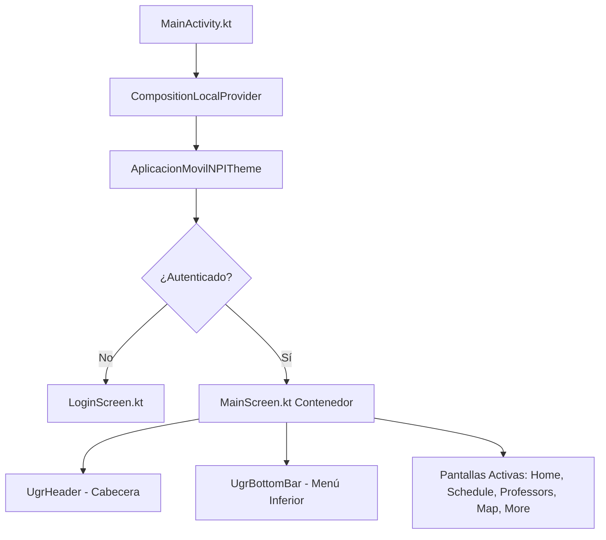
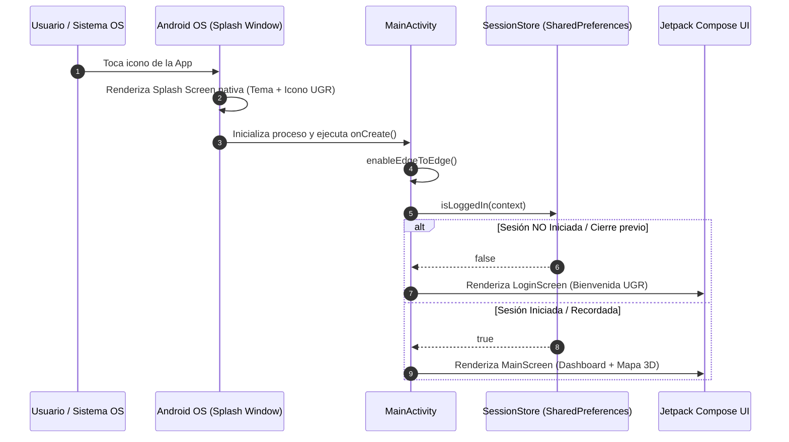
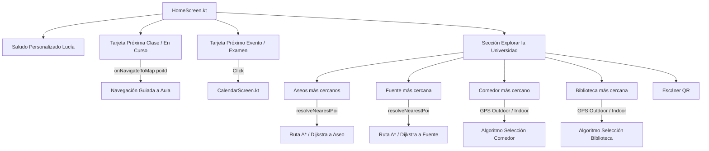
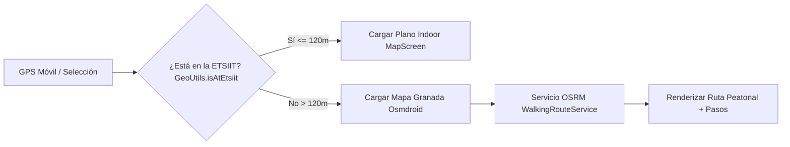
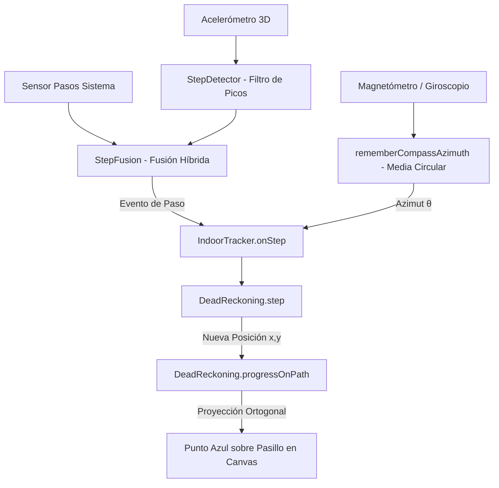
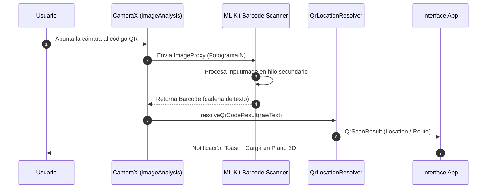
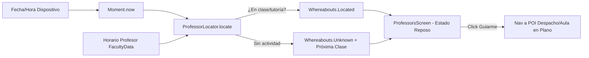
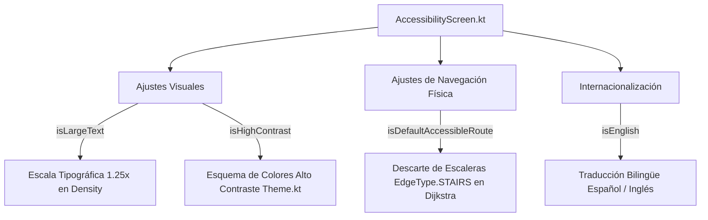

<div align="center">

# **UNIVERSIDAD DE GRANADA**

### **Escuela Técnica Superior de Ingenierías Informática y de Telecomunicación**
*Grado en Ingeniería Informática · Mención en Computación y Sistemas Inteligentes*

<br>


<br>

---

## **MEMORIA DEL PROYECTO PRÁCTICO**

# 📱 **SISTEMA INTEGRAL DE NAVEGACIÓN MULTIMODAL Y GESTIÓN ACADÉMICA PARA LA ETSIIT**

### *Posicionamiento Híbrido Indoor/Outdoor, Guiado por Grafo, Códigos QR y Servicios al Estudiante*

---

<br>

**Asignatura:** Nuevos Paradigmas de Interacción (NPI)  
**Curso Académico:** 2026 / 2027 — 4º Curso (CSI)  
**Profesor:** Marcelino José Cabrera Cuevas  

<br>

### 👥 **EQUIPO DE DESARROLLO (AUTORES)**

- **Alejandro Eufrasio Mercado Martínez**
- **Pedro Palacin Ruiz de la Escalera**
- **Francisco Liébana**
- **Rocío Aranguren**
- **Paula**

<br>

---

</div>

> [!NOTE]  
> **Nota sobre la colaboración en equipo:**  
> Aunque cada integrante ha asumido el liderazgo y la responsabilidad principal de un bloque funcional específico para la estructuración de la memoria y la defensa individual del proyecto, la fase de desarrollo ha sido completamente transversal y colaborativa. Todos los miembros del equipo han intervenido, apoyado e integrado código de forma conjunta a lo largo de los diferentes módulos del sistema.

<br>

---

## 🛠️ **DISTRIBUCIÓN DE RESPONSABILIDADES Y ÁREAS DE DEFENSA**

### **1. Alejandro Eufrasio Mercado Martínez**
**Bloque:** Arquitectura General, Autenticación y Pantallas Principales (UI/UX).  
**Enfoque para la defensa:** Explicar el punto de entrada de la aplicación en Android, la navegación principal de la app (`Scaffold`, `UgrHeader`, `UgrBottomBar`), la gestión de sesión del estudiante y el diseño del tema Material 3.

- **Ficheros asignados:**
  - `MainActivity.kt`: Actividad principal y punto de entrada de la aplicación.
  - `ui/MainScreen.kt`: Contenedor principal con `Scaffold`, `UgrHeader` y la barra de navegación inferior.
  - `ui/screens/HomeScreen.kt`: Pantalla de inicio con accesos rápidos y resumen del día.
  - `ui/screens/LoginScreen.kt` & `data/SessionStore.kt`: Inicio de sesión del alumno y persistencia de sesión.
  - `ui/screens/CalendarScreen.kt`: Pantalla de calendario académico de exámenes y eventos.
  - `ui/screens/MessagesScreen.kt`: Pantalla de notificaciones y avisos.
  - `ui/screens/ProfileScreen.kt`, `MoreScreen.kt` & `HelpScreen.kt`: Pantallas de Perfil, Menú secundario y Ayuda.
  - `data/Models.kt`: Modelos generales del dominio (Usuario, Avisos, Tareas, Asignaturas).
  - `ui/theme/*` & `ui/components/UgrIcons.kt`: Definición de paleta corporativa UGR, tipografías y tema Jetpack Compose.

---

### **2. Pedro Palacin Ruiz de la Escalera**
**Bloque:** Módulo de Códigos QR (Generación, Escaneo y Navegación QR).  
**Enfoque para la defensa:** Explicar cómo la app genera y comparte rutas mediante códigos QR, la integración de la cámara con CameraX y ML Kit para el escaneo en tiempo real, y la decodificación del contenido de las rutas y ubicaciones.

- **Ficheros asignados:**
  - `qr/QrGenerator.kt`: Generación del Bitmap / ImageBitmap del código QR a partir de cadenas de ruta usando ZXing.
  - `qr/QrLocationResolver.kt`: Decodificador e intérprete de contenidos QR (nodos, POIs y rutas).
  - `qr/QrScannerScreen.kt`: Vista e integración de cámara con CameraX y ML Kit Barcode Scanning.
  - `ui/screens/RouteQrDialog.kt`: Componente visual (modal) para mostrar el código QR generado.
  - `ui/screens/QrScanPanel.kt`: Botón y panel directo de escaneo rápido de QR.
  - `QrRouteTest.kt`: Pruebas unitarias de generación y resolución de QR.

---

### **3. Francisco Liébana**
**Bloque:** Navegación Indoor, Grafo de la Facultad y Algoritmo Dijkstra.  
**Enfoque para la defensa:** Explicar el modelo de datos del plano de la ETSIIT (nodos, aristas y POIs por plantas), el algoritmo de Dijkstra para el cálculo de rutas óptimas/accesibles y la visualización de los tramos de ruta en el plano.

- **Ficheros asignados:**
  - `navigation/RouteManager.kt`: Algoritmo de Dijkstra para cálculo de rutas (estándar y accesibles PMR).
  - `navigation/EtsiitData.kt`: Grafo de la facultad (plantas -1 a 4, coordenadas calibradas, nodos y conexiones).
  - `model/GraphModels.kt`: Estructuras de datos para Nodos, Aristas, POIs y tipos de transición (escaleras/ascensor).
  - `ui/screens/MapScreen.kt`: Interfaz del plano de la facultad, cambio de planta y renderizado de tramos de ruta en Canvas.
  - `RouteManagerTest.kt`: Pruebas unitarias del algoritmo de rutas.

---

### **4. Rocío Aranguren**
**Bloque:** Posicionamiento Indoor, Sensores del Dispositivo y Mapa Exterior.  
**Enfoque para la defensa:** Explicar cómo se utilizan los sensores físicos del teléfono (acelerómetro, podómetro y brújula/magnetómetro) para la estimación de pasos, navegación por estima indoor (*Dead Reckoning*) y la integración del mapa exterior con Osmdroid.

- **Ficheros asignados:**
  - `location/IndoorTracker.kt`: Seguimiento de posición en tiempo real sobre el plano indoor.
  - `location/LocationSensors.kt`: Gestión y lectura de sensores de Android (brújula, podómetro, acelerómetro y GPS).
  - `location/StepDetector.kt` & `location/DeadReckoning.kt`: Conteo de pasos y estimación del rumbo.
  - `location/GeoUtils.kt`: Utilidades de distancia geográfica (Haversine) y comprobación del recinto.
  - `ui/screens/CityMapPanel.kt`: Mapa de la ciudad con OpenStreetMap (Osmdroid) y GPS exterior.
  - `LocationTest.kt` & `WalkingRouteTest.kt`: Pruebas unitarias de sensores, movimiento y rutas peatonales.

---

### **5. Paula**
**Bloque:** Datos Académicos, Localizador de Profesorado y Servicios al Estudiante.  
**Enfoque para la defensa:** Explicar el modelo de datos de la facultad (grados, asignaturas, departamentos), la funcionalidad para buscar y localizar despachos de profesores en el plano, los horarios de clase y la consulta de notas.

- **Ficheros asignados:**
  - `data/FacultyData.kt`: Estructura de grados, asignaturas, departamentos y lista de profesores.
  - `data/ProfessorLocator.kt`: Lógica de vinculación y búsqueda en tiempo real entre despachos de profesores y el mapa.
  - `data/SampleData.kt`: Datos estáticos de muestra (horarios, avisos, notas y campus UGR).
  - `ui/screens/ProfessorsScreen.kt`: Pantalla de búsqueda de profesores y botón directo "Cómo llegar a despacho".
  - `ui/screens/ScheduleScreen.kt`: Pantalla de horario semanal de clases.
  - `ui/screens/GradesScreen.kt`: Pantalla de consulta de expediente y calificaciones.
  - `ui/screens/AccessibilityScreen.kt`: Pantalla de configuración de opciones de accesibilidad.
  - `ProfessorLocatorTest.kt`: Pruebas unitarias del buscador de despachos.

<br>

---

<div align="center">

**Granada, Curso Académico 2026 / 2027**

</div>

<div page-break-after="always"></div>

---

# **MEMORIA DESCRIPTIVA DEL PROYECTO**

---

## **1. ARQUITECTURA GENERAL Y FLUJO DE ARRANQUE**

### **1.1. Visión General del Sistema y Paradigma Reactivo**
La aplicación móvil de la **Escuela Técnica Superior de Ingenierías Informática y de Telecomunicación (ETSIIT)** de la Universidad de Granada (UGR) ha sido diseñada como un sistema integral de orientación, guiado y gestión académica. Combina múltiples paradigmas de interacción multimodal:
- **Navegación Visual e Interactiva:** Visualización de planos indoor por plantas y mapas urbanos exteriores.
- **Posicionamiento Híbrido:** Localización GPS en el exterior y navegación por estima (PDR) con fusión de sensores físicos en interiores.
- **Transferencia Inter-Dispositivo:** Compartición instantánea de rutas mediante códigos QR.
- **Asistencia Académica en Tiempo Real:** Localización del profesorado en directo, consulta de horarios semanales y expediente.
- **Accesibilidad Inclusiva:** Cálculo de rutas para Personas con Movilidad Reducida (PMR), modos de alto contraste y escalado tipográfico.

---

### **1.2. Arquitectura de Software y Paradigma Reactivo**
La aplicación está desarrollada íntegramente en **Kotlin** utilizando **Jetpack Compose**, el toolkit declarativo moderno recomendado por Google.



#### Principios Clave de la Arquitectura:
- **Paradigma Declarativo y Recomposición:** La interfaz gráfica se construye como una función directa del estado actual. Cuando cambia una variable observable (`State` / `mutableStateOf`), Compose ejecuta únicamente los componentes afectados (recomposición).
- **Contenedor Principal (`MainScreen.kt`):** Utiliza la estructura `Scaffold` de Jetpack Compose para mantener una cabecera superior corporativa (`UgrHeader`) y una barra de navegación inferior (`UgrBottomBar`) persistentes entre pantallas.
- **Entrada y Gestión de Estado (`MainActivity.kt`):** Punto de entrada que inicializa los proveedores globales mediante `CompositionLocalProvider` (`LocalDensity`, `LocalIsEnglish`, `LocalLargeText`, `LocalHighContrast`).
- **Tema Visual Dinámico (`Theme.kt` & `Color.kt`):** La función `AplicacionMovilNPITheme()` conmuta automáticamente entre la paleta de colores estándar (Rojo UGR `#85132E`, Tintas `#1F1A1D`) y el esquema de **Alto Contraste** según la preferencia configurada por el usuario.
- **Adaptación Tipográfica:** Cuando la variable de accesibilidad `isLargeText` está activa, la densidad tipográfica (`adaptedDensity`) multiplica por 1.25x la escala de fuentes (`fontScale`) en toda la aplicación.

---

### **1.3. Modelo de Datos Unificado (`Models.kt`)**
El fichero `Models.kt` define las estructuras de datos fundamentales (`data class` y `enum class`) utilizadas transversalmente por todos los módulos:

| Categoría | Clase / Modelo | Descripción y Propiedades |
| :--- | :--- | :--- |
| **Gestión Académica** | `WeeklySlot` | Franja horaria semanal. Contiene `semester`, `day`, `start`, `end`, `kind` (`CLASE`/`TUTORIA`), `title`, `place` y `poiId`. Calcula `startMinutes` y `endMinutes` mediante `toMinutes()`. |
| | `ClassLesson` | Clase simplificada para la interfaz con `time`, `end`, `name`, `room`, `tone` y `poiId` opcional. |
| | `DaySchedule` | Agrupación diaria con `short`, `day`, `date`, `month` y la lista `classes`. |
| | `Professor` | Ficha docente con `id`, `initials`, `name`, `role`, `department`, `email`, `phone`, `office`, `officePoiId`, `subjects`, `schedule`, `note` y `tone`. |
| | `GradeItem` | Calificación académica con `year`, `subject` y `grade`. |
| **Navegación y Plano** | `PointOfInterest` | Punto de interés con `id`, `nameEs`, `nameEn`, `category`, `nodeId`, `description` y `descriptionEn`. |
| | `RouteStep` | Paso individual de una ruta guiada con `instruction`, `distance`, `floor`, `isFloorChange` e `icon`. |
| | `CampusItem` | Tarjeta informativa de recinto universitario. |
| | `PlaceCategory` | Categoría rápida de filtrado en la pantalla de inicio. |
| **Calendario y Servicios**| `CalendarEventItem` | Evento con `id`, `title`, `subject`, `date`, `time`, `type` (`Entrega`/`Examen`) y `description`. |
| | `MailFolder` / `MailMessage` | Buzón (`INBOX`, `SENT`, `ARCHIVED`) y mensaje de correo simulado. |
| | `FaqItem` / `IncidenceTicket` | Preguntas frecuentes por categoría y ticket de soporte técnico. |

---

## **2. EL VIAJE DEL USUARIO: FLUJO DE ARRANQUE Y ACCESO**

### **2.1. Arranque de la App y Splash Screen Nativa**
Al iniciar la app, el sistema operativo ejecuta la ventana de carga nativa (**Splash Screen**) optimizada para Android 12+ (API 31+).



#### Aspectos Técnicos del Inicio:
- **Configuración en Manifiesto:** `MainActivity` se declara como filtro principal (`MAIN`/`LAUNCHER`) usando `@style/Theme.AplicacionMovilNPI` (`Theme.Material.Light.NoActionBar`) e icono corporativo `@mipmap/ic_launcher`.
- **Diseño Inmersivo:** `MainActivity.onCreate()` invoca `enableEdgeToEdge()` para extender los componentes Compose bajo las barras de estado y navegación del sistema.

---

### **2.2. Autenticación e Identificación Corporativa (`LoginScreen.kt` & `SessionStore.kt`)**
Antes de renderizar la interfaz principal, se evalúa síncronamente `SessionStore.isLoggedIn(context)` sobre `SharedPreferences`:
- **Si no está autenticado:** Se presenta `LoginScreen.kt`. Cuenta con una cabecera *Hero* decorada con el gradiente institucional rojo UGR (`#85132E` a `#C63655`), el escudo de la universidad, campos de entrada para credenciales `@correo.ugr.es`, casilla de verificación "Recordar cuenta" y botones de acceso directo.
- **Acceso Demostración:** El botón de acceso con un toque precarga las credenciales de la alumna de prueba **Lucía Martín García** (`lucia@correo.ugr.es`) y actualiza la variable persistente `isAuthenticated = true`.

---

### **2.3. Contenedor Principal de Navegación (`MainScreen.kt`)**
Tras iniciar sesión, `MainScreen.kt` asume el control del flujo:
- **Cabecera Superior (`UgrHeader`):** Incluye la marca corporativa "ETSIIT · UGR", "UGR CAMPUS" y el avatar circular con las iniciales del usuario (`LM`). Al pulsar el avatar, se despliega un menú flotante para acceder a "Mi Perfil" (`ProfileScreen.kt`) o cerrar sesión (`onLogout`), reiniciando el estado de autenticación.
- **Navegación Inferior (`UgrBottomBar`):** Menú fijo con 5 secciones principales: **Inicio**, **Horario**, **Profesorado**, **Mapa** y **Más**. La pestaña activa se resalta con el color rojo corporativo `UgrRed`.
- **Detección Automática de Mapa (`mapEntryKey` & GPS):** Al pulsar la pestaña del mapa, se incrementa la clave `mapEntryKey`. Esto fuerza a `MapScreen.kt` a re-evaluar la posición GPS del teléfono mediante `GeoUtils.isAtEtsiit()`: si el usuario está a menos de 120 metros de la facultad, se abre automáticamente el plano indoor 3D; en caso contrario, se presenta el mapa urbano exterior.

---

## **3. PANTALLA PRINCIPAL DE INICIO (`HomeScreen.kt`): PANEL DE CONTROL Y SERVICIOS INTELIGENTES**

La pantalla de inicio (`HomeScreen.kt`) se organiza verticalmente mediante el modificador `.verticalScroll()` y actúa como panel de mandos para el estudiante.



---

### **3.1. Dashboard Personalizado y Próxima Clase**
- **Saludo Dinámico:** Muestra un mensaje personalizado utilizando el nombre de la estudiante.
- **Tarjeta de Clase Actual / Próxima:** Consulta en tiempo real `SampleData.nextLesson(moment)` basándose en la fecha y hora del sistema. Muestra el título de la asignatura, horario, aula, planta y un botón prominente **"Guiarme al aula"**.
- **Enrutado Directo:** Al pulsar el botón, se ejecuta `onNavigateToMap(nextLesson.poiId)`. Este identificador se transmite a `MapScreen.kt` a través del parámetro `initialDestPoiId`, cargando automáticamente el plano de la planta correspondiente y calculando la ruta óptima desde la entrada o posición del usuario.

---

### **3.2. Calendario de Eventos Académicos**
Muestra la entrega de prácticas o examen más próximo recuperado de `SampleData.initialEvents` cuya fecha no haya expirado. Al pulsar sobre la tarjeta, el usuario navega directamente a la pantalla completa del calendario (`CalendarScreen.kt`).

---

### **3.3. Accesos Directos e Inteligencia de Proximidad**
La sección "Explorar la universidad" proporciona accesos rápidos que resuelven dinámicamente el destino óptimo:

1. **Aseos y Fuentes más Cercanas (`resolveNearestPoi()`):**
   - Invoca la función `resolveNearestPoi()`, la cual evalúa todos los candidatos de la facultad y calcula la ruta Dijkstra con `routeManager.calculateRoute()` desde la posición actual del usuario.
   - Elige el candidato que presente el menor coste acumulado de ruta. Para los aseos, la función `isAseo()` filtra por nombre/categoría ("aseo", "baño", "WC", "restroom") previa normalización de texto con `normalizePoiText()` (conversión a minúsculas y eliminación de diacríticos/tildes).
   - Respeta el ajuste de accesibilidad PMR si el usuario lo tiene activo. En el mapa exterior, muestra un aviso indicando que estas instalaciones están registradas únicamente en el interior de la ETSIIT.
2. **Comedor y Biblioteca más Cercana (Comportamiento Híbrido Indoor/Outdoor):**
   - **En mapa interior:** Dirige directamente al comedor y biblioteca de la ETSIIT.
   - **En mapa exterior:** Evalúa la distancia geodésica mediante `GeoUtils.distanceMeters()` entre la posición GPS actual del usuario y los **4 comedores** o **6 bibliotecas universitarias** distribuidas por los distintos campus de Granada (Fuentenueva, Cartuja, PTS, Centro, Aynadamar). Tras seleccionar la más cercana por coordenadas, solicita el cálculo de ruta peatonal a `WalkingRouteService.fetch()`.
3. **Escáner de Códigos QR:** Abre directamente el visor de cámara para escaneo de ubicaciones o rutas.

---

## **4. NAVEGACIÓN Y POSICIONAMIENTO MULTIMODAL (INTERIOR Y EXTERIOR)**

---

### **4.1. Mapa Exterior de Granada y Conexión Campus (`CityMapPanel.kt`, `GeoUtils.kt`, `WalkingRouteService`)**

Cuando el usuario se encuentra fuera del recinto de la facultad, la aplicación presenta el mapa urbano exterior basado en **Osmdroid**.



#### Aspectos Técnicos del Mapa Exterior:
- **Librería de Mapas:** Utiliza `MapView` de **Osmdroid** configurado con el servidor de teselas de FOSSGIS (`OpenStreetMap.de`).
- **Límites Geográficos y Zoom:** Restringe la navegación a la provincia de Granada mediante `BoundingBox` (`GRANADA_NORTH: 37.235`, `GRANADA_SOUTH: 37.12`, `GRANADA_EAST: -3.53`, `GRANADA_WEST: -3.68`) con niveles de zoom entre 12.5 y 19.0.
- **Cálculo de Distancia Haversine (`GeoUtils.kt`):**
  Calcula la distancia ortodrómica $d$ entre dos coordenadas decimales $a(\phi_1, \lambda_1)$ y $b(\phi_2, \lambda_2)$:
  $$a = \sin^2\left(\frac{\Delta \phi}{2}\right) + \cos(\phi_1) \cdot \cos(\phi_2) \cdot \sin^2\left(\frac{\Delta \lambda}{2}\right)$$
  $$d = 2 \cdot R \cdot \operatorname{atan2}\left(\sqrt{a}, \sqrt{1-a}\right)$$
  donde $R = 6.371.000 \text{ metros}$. La función `isAtEtsiit()` evalúa si $d \le 120 \text{ metros}$.
- **Rutas Peatonales OSRM (`WalkingRouteService`):**
  Envía peticiones HTTP a la API REST pública de OSRM (`routing.openstreetmap.de/routed-foot`). Parsea el JSON retornado decodificando las coordenadas GeoJSON, la distancia total en metros, la duración estimada en minutos y la lista de indicaciones de maniobra (`RouteInstruction`) traducidas al español.
- **Componentes UI y Selección:**
  - `CityPlacePickerSheet`: Selector modal de lugares universitarios UGR con filtros por tipo (`CityPlaceFilter`: `ALL`, `FACULTIES`, `LIBRARIES`, `DINING`, `OTHER`) y por campus.
  - `RouteInstructionsCard`: Tarjeta informativa con desglose de pasos y opción de cambiar al plano interior al llegar a la ETSIIT.
  - Marcadores gráficos personalizados: `campusMarker`, `labeledDot` (icono con etiqueta en Canvas), `placeMarker` y `simpleDotMarker`.

---

### **4.2. Modelo del Edificio ETSIIT: Grafo y Algoritmo de Rutas (`GraphModels.kt`, `EtsiitData.kt`, `RouteManager.kt`)**

La facultad está digitalizada como un grafo conexo ponderado distribuido en 6 niveles (Plantas -1, 0, 1, 2, 3 y 4).

#### Estructuras del Grafo (`GraphModels.kt`):
- `Node`: Punto físico en el plano con `id`, coordenadas $(x, y)$ calibradas en una cuadrícula de 0 a 1000 unidades, y número de `floor`.
- `Edge`: Arista bidireccional entre dos nodos con `weight` (coste del tramo), `type` (`WALKWAY`, `STAIRS`, `ELEVATOR`) y `isAccessible` (`true` para pasillos y ascensores; `false` para escaleras).
- `PointOfInterest`: Asocia un lugar seleccionable (ej: "Aula 0.4", "Conserjería", "Cafetería") con su nodo de acceso en el grafo.

```kotlin
data class Edge(
    val from: String,
    val to: String,
    val weight: Float,
    val type: EdgeType = EdgeType.WALKWAY,
    val isAccessible: Boolean = (type != EdgeType.STAIRS)
)
```

#### Algoritmo de Rutas Dijkstra (`RouteManager.kt`):
La función `calculateRoute(startPoiId, destPoiId, onlyAccessible)` ejecuta el algoritmo de Dijkstra con las siguientes particularidades:
1. **Filtro de Accesibilidad PMR:** Si `onlyAccessible = true`, se filtran las aristas descartando cualquier tramo marcado con `EdgeType.STAIRS`.
2. **Lista de Adyacencia No Dirigida:** Registra cada conexión en ambos sentidos para permitir tránsitos bidireccionales.
3. **Penalización por Atajos de Nivel (`FLOOR_CHANGE_TRANSIT_PENALTY`):** Para evitar que el algoritmo utilice un nodo de escalera o ascensor como atajo dentro de una misma planta (entrar y salir en la misma planta), se aplica una penalización de coste adicional si el estado del nodo de entrada proviene del mismo nivel.

---

### **4.3. Visualización e Interacción en el Plano Indoor (`MapScreen.kt`)**

`MapScreen.kt` gestiona la exploración del edificio y el renderizado gráfico de rutas:

- **Segmentación por Plantas (`parseRouteSegments()`):** Una vez calculada la lista ordenada de nodos con Dijkstra, la función `parseRouteSegments()` divide la ruta en tramos continuos por planta (`RouteFloorSegment`). Detecta automáticamente cuando se produce una transición de nivel (escalera o ascensor) y genera el texto instructivo correspondiente (`arrivalText()`).
- **Renderizado sobre Canvas (`FloorPlanCanvasOverlay`):** Componente personalizado que dibuja las imágenes de fondo de cada planta (archivos `.png` calibrados) y superpone:
  - Trazado de la ruta (línea roja `UgrRed` con grosor adaptativo).
  - Marcadores de origen (círculo verde `GreenStatus`) y destino (pin rojo con sombra).
  - Marcadores de transiciones verticales (iconos de ascensor o escaleras).
  - Indicador de posición y orientación del usuario en tiempo real (círculo azul con cono de dirección de brújula).
  - Gestos multitáctiles de zoom (*pinch-to-zoom*) y desplazamiento (*pan*).
- **Componentes Auxiliares:**
  - `ZoomableMapDialog`: Vista ampliada a pantalla completa con controles de zoom.
  - `RouteStepNavigationCard`: Indicaciones paso a paso de la planta activa.
  - `PoiRouteSelectorCard` & `PoiSelectorField`: Selector visual de origen/destino con fichas `PoiChip`.

---

### **4.4. Posicionamiento Indoor por Sensores y Navegación por Estima PDR (`LocationSensors.kt`, `IndoorTracker.kt`, `StepDetector.kt`, `DeadReckoning.kt`)**

Para determinar la posición del usuario dentro del edificio sin señal GPS, la app implementa un sistema de **Navegación por Estima Peatonal (PDR)**.



#### A. Podómetro por Software y Fusión de Sensores (`StepDetector.kt` & `LocationSensors.kt`):
- **Detector por Acelerómetro (`StepDetector`):** Mide el módulo de aceleración $|a| = \sqrt{x^2 + y^2 + z^2}$. Mantiene una línea base adaptativa que sigue a la gravedad y contabiliza un paso cuando la aceleración supera el umbral de $\Delta > 1.2 \text{ m/s}^2$ tras un intervalo mínimo de $300 \text{ ms}$.
- **Fusión Híbrida (`StepFusion`):** Los podómetros por hardware del sistema (`TYPE_STEP_DETECTOR`) suelen presentar retardos iniciales de 5 a 10 pasos. `StepFusion` utiliza el acelerómetro para registrar los pasos de forma inmediata y, en cuanto el sensor del sistema comienza a emitir eventos, silencia el acelerómetro para evitar conteos dobles.

#### B. Brújula y Media Circular (`rememberCompassAzimuth`):
- Utiliza `TYPE_ROTATION_VECTOR` (o la combinación de acelerómetro + campo magnético `TYPE_MAGNETIC_FIELD`).
- Aplica filtrado por **media circular** mediante funciones senoidales y cosenoidales para suavizar el rumbo y evitar saltos de discontinuidad en el paso de $359^\circ$ a $0^\circ$:
  $$s = (1-k)\sin(\theta_{prev}) + k\sin(\theta_{nuevo})$$
  $$c = (1-k)\cos(\theta_{prev}) + k\cos(\theta_{nuevo})$$
  $$\theta_{suave} = \operatorname{atan2}(s, c)$$

#### C. Algoritmo de Desplazamiento PDR y Proyección Ortogonal (`DeadReckoning.kt` & `IndoorTracker.kt`):
Cada paso detectado desplaza la coordenada $(x, y)$ una zancada $L_{zancada} = 1.1 \text{ m}$ ($\sim 6 \text{ unidades del plano/metro}$) en la dirección del azimut $\theta$ corregido por la desviación del norte del plano $\theta_{norte}$:
$$x_{nuevo} = x_{actual} + \sin(\theta - \theta_{norte}) \cdot L_{zancada} \cdot \text{UNITS\_PER\_METER}$$
$$y_{nuevo} = y_{actual} - \cos(\theta - \theta_{norte}) \cdot L_{zancada} \cdot \text{UNITS\_PER\_METER}$$

Posteriormente, `progressOnPath()` calcula la proyección ortogonal más cercana sobre los segmentos de la ruta activa, garantizando que el punto azul avance suavemente por los pasillos sin atravesar muros. La calibración de brújula se persiste con `LocationPrefs`.

---

## **5. MÓDULO DE CÓDIGOS QR: GENERACIÓN, ESCANEO Y TRANSMISIÓN INTER-DISPOSITIVO**

---

### **5.1. Arquitectura del Módulo QR**
El módulo permite compartir rutas y posicionarse instantáneamente escaneando códigos QR situados en el edificio:

| Componente | Fichero | Responsabilidad Principal | Tecnologías |
| :--- | :--- | :--- | :--- |
| **Generador QR** | `qr/QrGenerator.kt` | Codificación de cadenas de texto y renderizado de QR a Bitmap / ImageBitmap. | ZXing (`QRCodeWriter`), `Bitmap` |
| **Intérprete** | `qr/QrLocationResolver.kt` | Análisis y resolución de payloads escaneados a tipos del dominio. | Sealed Classes `QrScanResult` |
| **Escáner Cámara** | `qr/QrScannerScreen.kt` | Captura de vídeo en tiempo real y detección de códigos. | CameraX, ML Kit Barcode Scanning |
| **Diálogo Modal** | `ui/screens/RouteQrDialog.kt` | Ventana modal Compose para mostrar el QR generado. | Jetpack Compose `Dialog` |
| **Botón Acción** | `ui/screens/QrScanPanel.kt` | Botón `QrScanButton` para lanzar el escáner flotante. | Material 3 |
| **Pruebas Unitarias**| `QrRouteTest.kt` | Verificación de generación, parseo y casos de prueba límite. | JUnit 4 |

---

### **5.2. Generación de Códigos QR de Ruta (`QrGenerator.kt` & `RouteQrDialog.kt`)**
- **Protocolo de Contenido:** Genera cadenas con el formato `ROUTE:<startPoiId>:<destPoiId>:<isAccessible>`.
- **Codificación ZXing:** `QRCodeWriter().encode()` transforma la cadena en una matriz de bits `BitMatrix`, renderizando un `Bitmap` o `ImageBitmap` de Compose de 512x512 píxeles.
- **Diálogo Modal (`RouteQrDialog.kt`):** Presenta una ventana emergente con el código QR, resumen del trayecto (Origen $\to$ Destino), distintivo de accesibilidad PMR e instrucciones de uso.

---

### **5.3. Escaneo en Tiempo Real con Visión por Computador (`QrScannerScreen.kt` & `QrScanPanel.kt`)**
Combina la captura de vídeo de **CameraX** con la detección de inteligencia artificial en dispositivo de **Google ML Kit Barcode Scanning**.



#### Innovaciones Clave del Escáner:
- **Control de Presión Trasera (Backpressure):** Configura `ImageAnalysis.STRATEGY_KEEP_ONLY_LATEST` para procesar únicamente el último fotograma capturado, descartando frames intermedios para evitar sobrecalentamiento o retardos.
- **Lifecycle Binding:** Vincula la cámara al ciclo de vida de Compose mediante `cameraProvider.bindToLifecycle()`, apagando el hardware de la cámara automáticamente al salir de la vista.

---

### **5.4. Decodificación e Interpretación de Datos (`QrLocationResolver.kt`)**
Parsea el texto leído y retorna un tipo sellado `QrScanResult`:
1. `QrScanResult.Route`: Carga automáticamente la ruta entre los dos POIs especificando si es accesible.
2. `QrScanResult.Location`: Fija la posición del usuario en el plano indoor al escanear el QR situado en la puerta de un aula o despacho. También soporta rutas históricas separadas por comas.

---

## **6. GESTIÓN ACADÉMICA, DOCENTE Y SERVICIOS AL ESTUDIANTE**

---

### **6.1. Directorio y Localización de Profesorado en Tiempo Real (`FacultyData.kt`, `ProfessorLocator.kt`, `ProfessorsScreen.kt`)**

| Componente | Fichero | Responsabilidad Principal | Tecnologías |
| :--- | :--- | :--- | :--- |
| **Estructura Académica** | `data/FacultyData.kt` | Directorio de profesores, asignaturas, departamentos y resolución de aulas a POIs. | `Professor`, `WeeklySlot` |
| **Buscador Profesorado** | `data/ProfessorLocator.kt` | Algoritmo de estado del profesor en tiempo real y cálculo de siguiente franja. | `Moment`, `Whereabouts` |
| **Proveedor Datos** | `data/SampleData.kt` | Datos estáticos de horarios, entregas, FAQs y expediente. | `DaySchedule`, `GradeItem` |
| **Vista Profesores** | `ui/screens/ProfessorsScreen.kt` | Búsqueda de profesores, disponibilidad en vivo y botón "Guiarme a despacho". | Compose `LazyColumn`, Corrutinas |
| **Vista Horario** | `ui/screens/ScheduleScreen.kt` | Selector semanal de clases con indicador de hora/aula y guiado. | Compose State, `Surface` |
| **Vista Expediente** | `ui/screens/GradesScreen.kt` | Consulta de notas por curso (1º a 4º), nota media acumulada y créditos ECTS. | Compose `verticalScroll` |
| **Vista Accesibilidad** | `ui/screens/AccessibilityScreen.kt` | Ajustes de tipografía grande, alto contraste y rutas accesibles PMR. | Compose `Switch` |
| **Pruebas del Buscador** | `ProfessorLocatorTest.kt` | Verificación de horarios, resolución de POIs y ordenación temporal. | JUnit 4 |



#### A. Modelo de Datos del Profesorado (`FacultyData.kt`):
Almacena fichas completas de los profesores de la ETSIIT con su departamento, correo, teléfono, despacho, asignaturas impartidas y lista de franjas semanales (`WeeklySlot`). Asocia las aulas con los POIs del plano mediante `roomPoiId()`.

#### B. Algoritmo de Localización en Tiempo Real (`ProfessorLocator.kt`):
- **Modelo Temporal (`Moment`):** Convierte el instante del sistema a `semester` (1 o 2), `day` (1=Lunes ... 7=Domingo) y `minutes` desde medianoche.
- **Función `locate()`:** Compara el `Moment` actual con la lista de clases y tutorías del profesor. Si coincide, devuelve `Whereabouts.Located(slot)`. En caso contrario, calcula la siguiente franja lectiva de la semana mediante `nextSlot()`, realizando un bucle circular entre el viernes tarde y el lunes mañana (`Math.floorMod`).
- **Interfaz `ProfessorsScreen.kt`:** Muestra una lista filtrable con tarjetas de profesor (`ProfessorCard`), estado en directo ("En clase", "En tutoría") y el botón **"Guiarme a despacho / aula"**, que envía al usuario directamente a la posición en el mapa indoor.

---

### **6.2. Horario Semanal de Clases (`ScheduleScreen.kt` & `SampleData.kt`)**
- **Selector Diario:** Fila superior con los días lectivos de la semana (Lunes a Viernes) y las fechas del mes calculadas dinámicamente con `SampleData.weekSchedule()`.
- **Tarjetas de Asignatura (`LessonCard`):** Muestran el intervalo horario, aula, título completo expandido mediante `SampleData.lessonName()` y el botón **"Cómo llegar al aula"** habilitado si el aula está digitalizada en el plano.

---

### **6.3. Expediente y Calificaciones (`GradesScreen.kt`)**
Muestra el historial académico simulado de la estudiante:
- **Resumen Acumulado:** Banner superior con la nota media global calculada dinámicamente ($8.4 / 10$) sobre las asignaturas superadas y el indicador de **180 ECTS Aprobados**.
- **Filtro por Curso:** Selectores para examinar calificaciones de 1º, 2º, 3º y 4º curso ("En curso").
- **Acción Adicional:** Botón para simular la descarga del resguardo oficial de expediente en formato PDF.

---

### **6.4. Servicios Complementarios y Menú Más (`MoreScreen.kt`, `CalendarScreen.kt`, `MessagesScreen.kt`, `HelpScreen.kt`, `ProfileScreen.kt`)**
Desde la pestaña **"Más"** (`MoreScreen.kt`), el estudiante accede a servicios adicionales:
1. **Idioma:** Pop-up bilingüe controlado por la variable `isEnglish`.
2. **Expediente y Notas:** Acceso a `GradesScreen.kt`.
3. **Calendario y Entregas (`CalendarScreen.kt`):** Consulta e inserción de entregas de prácticas y exámenes (`initialEvents`).
4. **Mensajes y Avisos (`MessagesScreen.kt`):** Buzón de comunicaciones institucionales simuladas (`initialMails`).
5. **Soporte y Ayuda (`HelpScreen.kt`):** Lista de preguntas frecuentes (`faqs`) y formulario de reporte de incidencias técnicas.
6. **Accesibilidad (`AccessibilityScreen.kt`):** Ajustes de visualización y navegación física.
7. **Mi Perfil (`ProfileScreen.kt`):** Ficha con la información personal de la estudiante Lucía Martín García.

---

## **7. ACCESIBILIDAD Y PERSONALIZACIÓN GLOBAL DE LA APLICACIÓN**

El panel de ajustes de accesibilidad (`AccessibilityScreen.kt` & `AccessibilityStore.kt`) centraliza las opciones de inclusión:



1. **Tamaño de Texto Ampliado (`isLargeText`):** Aumenta un $25\%$ la escala tipográfica global mediante la densidad adaptada `adaptedDensity` en `MainActivity.kt`.
2. **Esquema de Alto Contraste (`isHighContrast`):** Modifica la paleta de colores en `Theme.kt` sustituyendo fondos suaves por contrastes negros y bordes de alta visibilidad.
3. **Ruta Accesible por Defecto (`isDefaultAccessibleRoute`):** Configura el motor Dijkstra de `RouteManager` para marcar activado por defecto el modo accesible PMR, excluyendo tramos de escaleras.
4. **Bilingüismo (`isEnglish` & `LanguageStore.kt`):** Conmuta instantáneamente la totalidad de las etiquetas y mensajes de la interfaz entre español e inglés.

---

## **8. SUITE DE PRUEBAS UNITARIAS Y VERIFICACIÓN DEL SISTEMA**

La calidad y corrección del código se verifican mediante una suite de **43 pruebas unitarias automatizadas (`JUnit 4`)**:

| Fichero de Test | Módulo Evaluado | Escenarios Comprobados |
| :--- | :--- | :--- |
| `RouteManagerTest.kt` | Grafo y Dijkstra | - Trazado de rutas válidas entre la entrada y las aulas.<br>- Bloqueo efectivo de tramos de escaleras en modo accesible PMR.<br>- Verificación de alternativas por ascensor. |
| `LocationTest.kt` | GPS, Podómetro y PDR | - Cálculo de distancia geodésica Haversine (ETSIIT a Ciencias ~2.3 km).<br>- Comprobación del recinto ETSIIT ($d \le 120\text{m}$).<br>- Detección de picos de aceleración con `StepDetector`.<br>- Fusión híbrida de pasos con `StepFusion` sin duplicación.<br>- Avance trigonométrico PDR y proyección ortogonal en `IndoorTracker`. |
| `WalkingRouteTest.kt` | Rutas Exteriores OSRM | - Parseo de respuestas JSON de OSRM.<br>- Generación de indicaciones textuales de maniobras en rotondas y bifurcaciones.<br>- Formato legible de tiempos y distancias. |
| `QrRouteTest.kt` | Módulo de Códigos QR | - Serialización de rutas en formato `ROUTE:<origen>:<destino>:<accesible>`.<br>- Decodificación de resultados de localización y rutas.<br>- Manejo seguro de códigos QR malformados o no reconocidos. |
| `ProfessorLocatorTest.kt` | Localización de Profesores | - Identificación de profesores en clase de teoría, laboratorio o tutoría.<br>- Transición exacta en la hora de fin de clase.<br>- Cálculo circular de la siguiente franja lectiva dando la vuelta a la semana.<br>- Verificación de que todos los despachos y aulas existen en `EtsiitData.pois` y tienen ruta navegable. |

---

## **9. CONCLUSIÓN**

La aplicación móvil de la ETSIIT integra con éxito la navegación espacial interior y exterior con los servicios académicos cotidianos de la universidad. Gracias a su arquitectura modular en Jetpack Compose, el uso de visión por computador en el dispositivo (CameraX + ML Kit), la fusión inteligente de sensores físicos para la navegación indoor y un diseño inclusivo desde la base, la aplicación ofrece una experiencia de usuario fluida, accesible y de alta utilidad práctica para toda la comunidad universitaria de la Universidad de Granada.
